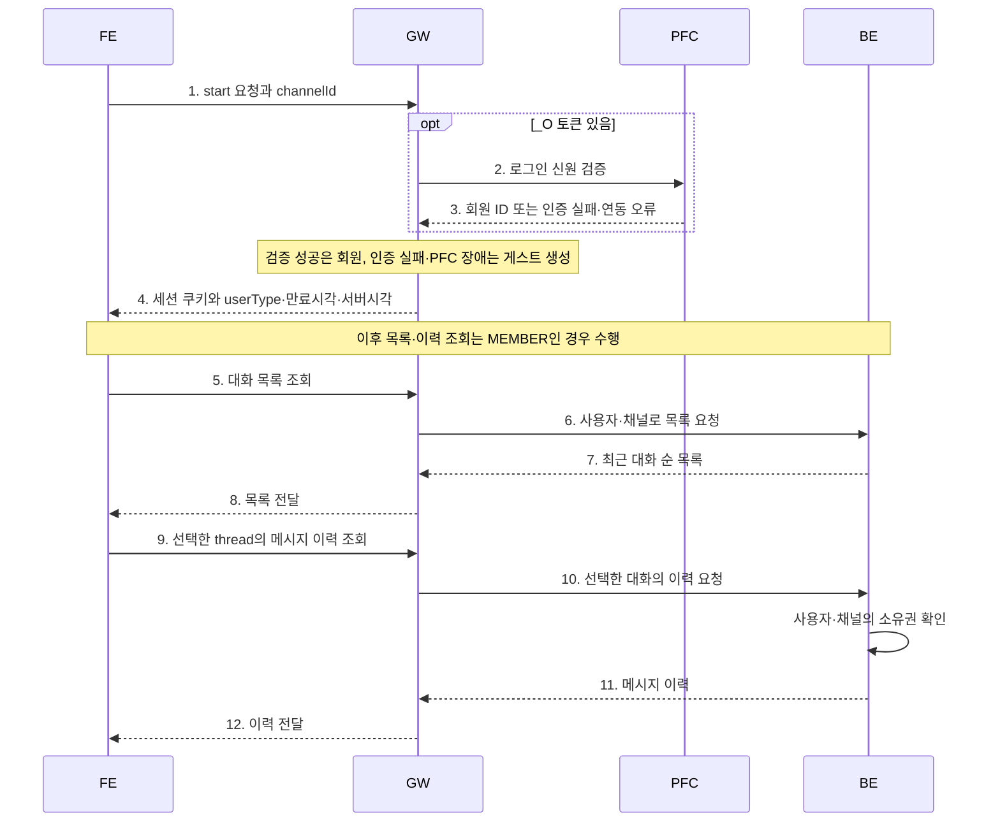

# Agent API G/W 설계

2026-10-23

| 구분 | 엔드포인트 | 용도 |
|---|---|---|
| A. start | `POST /api/auth/session` | _O 인증·채널별 세션 생성 또는 재사용 |
| B. 클릭 기록 | `POST /api/click` | 화면 활동 기록·세션 연장 |
| C. 자동완성 | `POST /api/chat/auto` | 검색어 자동완성 |
| D. B/E 중계 | `/api/chat` 및 하위 경로 | [B/E 연동 명세](backend-integration-spec.md) 참고 |
| E. 통합인증 | `POST /api/chat` + `X-Mfa-Result` | [통합인증 명세](unified-auth-spec.md) 참고 |

이 문서는 G/W 인터페이스 규격임.

## 진입 순서

FE가 세션 상태와 로그인 복귀 여부를 판단해 start를 호출함. start는 `POST /api/auth/session`을 의미함. 회원 세션을 확보한 뒤 대화 목록과 선택한 대화의 이력을 조회함.



FE는 목록의 최근 thread를 선택함. 목록이 없거나 새 대화를 시작하면 FE가 새 threadId를 생성해 채팅 요청 본문에 사용함. 게스트는 목록 조회 대신 새 대화를 시작함. B/E의 만료된 대화는 이력 표시가 가능하며 발화 재개는 B/E의 대화 만료 정책을 따름.

## 공통

세션을 사용하는 모든 FE→G/W 요청은 query `channelId`가 필수임. 허용된 전체 채널 ID를 보내며 G/W는 첫 번째 하이픈 앞 구간으로 쿠키를 선택함.

```text
채널: 11111111-1111-4111-8111-111111111111
쿠키: __Host-sh-session_11111111
요청: POST /api/chat?channelId=11111111-1111-4111-8111-111111111111
```

채널별 로그인·활동 연장은 독립적임. 쿠키 접두사가 같은 허용 채널은 등록할 수 없음. channelId 누락·중복·공백은400, 미허용 채널이나 조회한 세션의 채널 불일치는403임. 선택한 채널의 쿠키가 없으면 세션 생성 외 요청은401임.

### 세션

| 항목 | 규칙 |
|---|---|
| 쿠키 | `__Host-sh-session_<channel-prefix>`. HttpOnly, Secure, SameSite=Lax, Path=/ |
| 보관 | 세션 서비스에 SID 해시·사용자·회원 여부·채널·상태·활동/만료시각 저장 |
| 만료 | 마지막 인정 활동부터 5분 |
| 인정 활동 | 세션 POST·채팅·도구 POST·클릭. 유효한 활동 요청을 수신할 때마다 연장 |
| 연장 제외 | GET·SSE 수신·heartbeat·자동완성 |
| 회원 ID | PFC에서 검증한 PID. P 시작 총10자리 |
| 게스트 ID | 세션 서비스 발급. G 시작 총13자리 |
| 채널 | 세션에 저장한 channelId로 접근 권한 및 B/E 목적지 결정 |
| 대화 | FE가 threadId를 선택·생성하고 요청에 전달. B/E가 소유권·이력·만료를 관리 |

POST는 동일 Origin·Fetch Metadata를 검사함. 업무 요청의 중복 처리는 B/E가 담당함.

### 공통 응답 헤더

| 헤더 | 형식 | 값 |
|---|---|---|
| `X-Chat-User-Type` | string | MEMBER 또는 GUEST |
| `X-Chat-Auth-Expires-At` | int64 | G/W 세션 만료시각 |
| `X-Server-Time` | int64 | 서버 시각 |

G/W→FE의 모든 API 응답에 적용함. 유효 세션을 확인한 경우 세 헤더를 반환하며 JSON·SSE·B/E 오류 응답에도 포함함. 세션이 없거나 만료됐거나 유효성을 확인할 수 없으면 X-Server-Time만 반환함. 이 값은 G/W가 설정하는 응답 정보임.

시각은 UTC epoch milliseconds임. FE는 start 응답 본문과 공통 헤더로 회원 여부·만료 타이머를 갱신함. GET·자동완성은 현재 만료시각을 반환하며 세션을 연장하지 않음. SSE는 스트림 시작 시 한 번 전달하고 수신 중에는 갱신하지 않음.

```http
X-Chat-User-Type: GUEST
X-Chat-Auth-Expires-At: 1792638300000
X-Server-Time: 1792638000000
```

### 오류 응답

```json
{"error":{"code":401,"status":"UNAUTHENTICATED","message":""}}
```

HTTP 상태와 error.code는 같음. message는 항상 빈 문자열이며 FE가 status별 안내 문구를 표시함.

| 상태코드 | status | 조건 |
|---|---|---|
| 400 | INVALID_ARGUMENT | 필수값·형식 오류 |
| 401 | UNAUTHENTICATED | 보호 API의 세션 부재, 기존 세션의 만료·폐기 또는 잘못된 SID 재사용 |
| 403 | PERMISSION_DENIED | 채널·접근 권한 불일치 |
| 404 | NOT_FOUND | 지원하지 않는 경로 |
| 405 | METHOD_NOT_ALLOWED | 허용되지 않는 메서드 |
| 503 | UNAVAILABLE | 세션 서비스·검색·접근 권한 확인 등 필수 의존 서비스 장애 |
| 500 | INTERNAL_ERROR | 그 밖의 내부 오류 |

start의 _O 인증 실패·PFC 장애는 게스트 생성으로 처리함. 업무 통합인증 오류는 통합인증 명세를 따름. B/E의 HTTP 오류와 SSE 본문은 원문 중계하고 공통 응답 헤더를 설정함.

## A. start — POST /api/auth/session

### 요청

| 위치 | 이름 | 형식 | 필수 | 설명 |
|---|---|---|---|---|
| query | channelId | uuid | Y | 허용된 전체 채널 ID |
| cookie | 플랫폼 _O 3종 | string | 회원 인증 시 | PlatformSystemCode_O, PlatformAuthentication_O, PlatformVerify_O |
| cookie | 채널별 세션 쿠키 | string | N | 유효 세션 재사용에 사용 |

```http
POST /api/auth/session?channelId=11111111-1111-4111-8111-111111111111
```

start는 로그인 세션을 준비하는 요청임. 요청 본문 없이 호출함.

| 조건 | 처리 |
|---|---|
| _O 검증 성공 | PFC가 확인한 PID로 해당 채널의 회원 세션 생성·쿠키 발급. 사용한 _O 삭제 |
| _O 검증 실패·형식 오류·일부 누락 | 세션 서비스로 해당 채널의 게스트 세션 생성 |
| 로그인 검증 중 PFC 오류·timeout·비정상 응답 | 세션 서비스로 해당 채널의 게스트 세션 생성 |
| _O 없음·유효 채널 세션 있음 | 해당 세션 재사용 및 활동 연장 |
| _O 없음·채널별 세션 쿠키 없음 | 게스트 세션 생성. 게스트 ID는 세션 서비스가 발급 |
| _O 없음·기존 세션 만료 | 401 UNAUTHENTICATED. 해당 채널의 만료된 세션 쿠키 삭제 |
| _O 없음·잘못되거나 폐기된 SID | 401 UNAUTHENTICATED |
| 세션 서비스 생성·조회·갱신 실패 | 503 UNAVAILABLE |

세션 생성·저장은 agent-session-service가 담당하고 G/W는 반환된 세션을 사용함. _O를 포함한 start는 로그인 인증 결과로 새 세션을 생성하고, _O가 없으면 기존 채널 세션을 확인함. 기존 세션 만료와 _O 인증 실패는 구분함. staging은 허용 목록의 회원만 접근하며 게스트 접근은403임.

### 응답

회원·게스트 모두 200 + 채널별 세션 쿠키 + 공통 응답 헤더.

```json
{"userType":"MEMBER","expiresAt":1792638300000,"serverTime":1792638000000}
```

게스트 생성 시 userType은 `GUEST`이며 응답 형식은 같음. userType은 문자열 `MEMBER` 또는 `GUEST`로 사용함.

| 필드 | 형식 | 설명 |
|---|---|---|
| userType | string | MEMBER 또는 GUEST |
| expiresAt | int64 | 세션 만료시각 |
| serverTime | int64 | 서버 시각 |

threadId는 세션 생성 요청·응답·저장 정보에 포함하지 않음. G/W는 요청에 담긴 대화 ID를 B/E로 전달하고, B/E가 요청 사용자·채널의 대화인지 확인함.

## B. 클릭 기록 — POST /api/click

### 요청

유효 세션 쿠키가 필요함. 본문 최대 1MiB.

| 본문 | 형식 | 필수 | 설명 |
|---|---|---|---|
| threadId | string | Y | FE가 선택한 대화 ID. 클릭 로그에 기록 |
| scenarioId | string | Y | 시나리오 ID |
| state | string | Y | 화면 진행 상태 |
| component | string 또는 object | Y | 클릭 컴포넌트 |
| buttonInfo | object | N | buttonType, buttonNm, buttonUrl, buttonUtterance, phoneNumber 문자열 |

```json
{"threadId":"thread-001","scenarioId":"lost-card","state":"select-card","component":"confirm"}
```

### 응답

```json
{"status":"OK"}
```

200과 만료 응답 헤더를 반환함. G/W가 세션을 연장하고 JSON 활동 로그를 기록함. 재전송 로그는 중복될 수 있으며 200은 수집기의 영구 적재를 보장하지 않음. 입력에 인증값·민감정보를 넣지 않음.

## C. 자동완성 — POST /api/chat/auto

### 요청

유효 게스트·회원 세션이 필요함.

| 본문 | 형식 | 필수 | 설명 |
|---|---|---|---|
| queryText | string | Y | 공백이 아닌 검색어 |
| size | int | N | 기본10, 1~1000 |
| channel | string | N | 검색 인덱스. 기본 sol-chat |

```json
{"queryText":"카드","size":10,"channel":"sol-chat"}
```

### 응답

```json
{"code":"SUCCESS","message":"성공","data":{"totalCount":0,"chatResponse":[]}}
```

검색 서비스 응답을 사용함. highlight의 HTML은 FE에서 허용 태그만 렌더링함. 검색 channel은 세션의 인증 채널과 별개임.

## 대화·접근 규칙

| 상황 | 처리 |
|---|---|
| 대화 선택 | FE가 목록의 threadId로 이력을 조회하고 같은 ID로 채팅 |
| 새 대화 | FE가 새 threadId를 생성해 POST /api/chat에 전달. B/E가 새 대화 생성 |
| 게스트→회원 | 플랫폼 로그인 후 _O를 포함해 start 호출. 대화 소유권 연결은 B/E 책임 |
| 쿠키 유실 | FE가 start 호출. MEMBER이면 목록·이력 조회, GUEST이면 새 대화. 회원 복구에는 새로운 _O 인증 필요 |
| 세션 만료 | G/W가 401과 해당 채널의 만료된 세션 쿠키 삭제를 반환. FE는 start로 세션을 준비하고 userType에 따라 분기 |
| 홈페이지 연동 | 회원 start·채팅/도구 응답에 _I 쿠키 발급. GET·게스트·클릭 제외 |
| staging | 허용 목록의 회원만 접근. 검증된 세션 채널로 목적지 선택 |

G/W 로그인 세션 만료와 B/E 대화 만료는 각각 적용됨. B/E는 채팅·이력·위자드·interrupt 재개에서 사용자·채널의 소유권과 실행 상태를 검사함.
