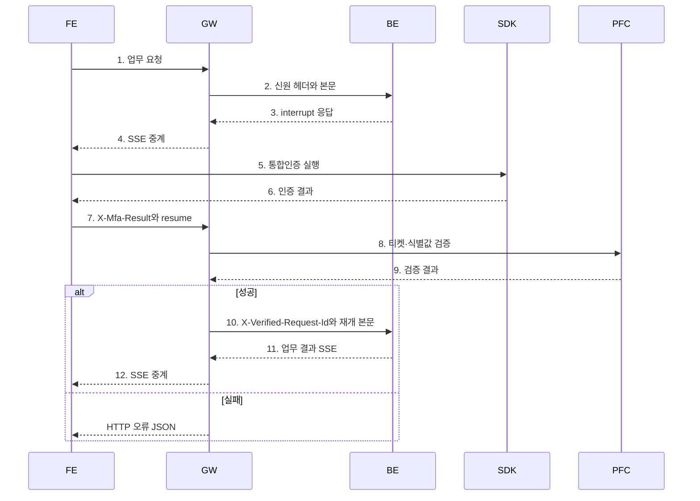

# 통합인증 연동 명세

2026-10-23

| 엔드포인트 | 용도 |
|---|---|
| `POST /api/chat` + `X-Mfa-Result` | 인증 결과 검증 후 interrupt 재개 |

start로 로그인 세션을 준비한 뒤 통합인증 요청을 수행함. 이 문서는 통합인증 요청·응답 규격임. 대화 본문은 [B/E 연동 명세](backend-integration-spec.md)를 따름. start의 로그인 검증과 달리 업무 통합인증 실패·PFC 장애는 게스트 전환 없이 오류로 반환함.

## 역할

| 주체 | 역할 |
|---|---|
| FE | SDK 실행·인증 결과 제출 |
| G/W | 세션 확인·PFC 검증·검증된 interrupt ID 전달 |
| B/E | interrupt·업무 관리, 검증 헤더 확인, 중복 실행 방지 |
| PFC | 티켓 검증·소비·기한·재시도 제한 |

## 흐름



## 요청

### 헤더·쿠키

요청 query `channelId`는 필수임. 전체 채널 ID를 보내며 G/W는 해당 채널의 첫 구간에 대응하는 세션 쿠키를 사용함.

| 위치 | 이름 | 필수 | 설명 |
|---|---|---|---|
| cookie | __Host-sh-session_<channel-prefix> | Y | G/W 세션 |
| cookie | __state_as_id | Y | PFC 인증 상태값 |
| header | X-Mfa-Result | Y | 인증 입력 JSON 객체의 UTF-8 base64url. padding 없음, 기본 한도4096자 |

인증 입력은 orchestrator `/api/auth/stream`의 AuthRequest 필드를 사용함.

| 인증 입력 | 형식 | 필수 | 설명 |
|---|---|---|---|
| identifier.ssn | string | Y | 보호된 식별값 |
| identifier.iPin | string | Y | 고객 식별값 |
| 금융인증서 전자서명 여부 | boolean | N | Identifier의 isFinanceCaESign 속성. JSON 키는 AuthRequest 직렬화 규격을 따름 |
| ticketIds | string[] | Y | 비어 있지 않은 티켓 목록 |
| code | string | Y | 인증 코드 |
| source / componentId | string | N | 요청 출처·화면 식별값 |

X-Mfa-Result 인코딩 전 예시:

```json
{
  "identifier":{"ssn":"<보호 식별값>","iPin":"<고객 식별값>"},
  "ticketIds":["<인증 티켓>"],
  "code":"<인증 코드>"
}
```

### 본문

RunAgentInput의 resume에 인증 대상 하나를 넣음. 도구 내 interrupt는 1회이며 통합인증은 단일 ID만 처리함.

```json
{
  "threadId":"thread-001",
  "runId":"1",
  "messages":[{"id":"user-001","role":"user","content":"카드 분실신고 해줘"}],
  "tools":[],
  "context":[],
  "forwardedProps":null,
  "resume":[{"interruptId":"int-3","status":"resolved","payload":{}}]
}
```

interruptId는 B/E가 반환한 ID이며 payload는 responseSchema를 따름. 빈/중복 인증 헤더, 잘못된 인코딩·JSON, 복수 resume, cancelled와 인증 결과 동시 제출은 400임.

## 성공 처리

G/W가 로그인 세션과 요청 형식을 확인하고 PFC로 티켓·식별값을 검증함. 성공 시 B/E에 다음 헤더와 업무 본문을 전달함.

```http
POST /api/chat
Content-Type: application/json
X-Authenticated-User-Id: P123456789
X-Authenticated-Channel-Id: 11111111-1111-4111-8111-111111111111
X-Verified-Request-Id: int-3
```

검증 헤더는 G/W가 직접 설정함. B/E는 대기 interrupt의 사용자·thread·ID·resolved 상태를 확인하고 중복 없이 실행함. 응답은 B/E의 SSE를 중계함.

X-Mfa-Result가 없으면 일반 요청으로 전달함. **B/E는 인증이 필요한 interrupt에 검증 헤더가 없거나 ID가 다르면 실행을 거절해야 함.** cancelled는 인증 성공으로 처리하지 않음.

## 실패 응답

B/E를 호출하지 않고 SSE 시작 전에 반환함.

```json
{"error":{"code":403,"status":"MFA_INVALID","message":""}}
```

| 상태코드 | status | 조건 |
|---|---|---|
| 400 | INVALID_ARGUMENT | 인증 입력·쿠키·resume 형식 오류 |
| 401 | UNAUTHENTICATED | G/W 세션 부재·만료·폐기 |
| 403 | MFA_INVALID | PFC 인증 거절·식별값 불일치·PFC가 거절한 만료/소비 티켓 |
| 503 | UNAVAILABLE | PFC 통신 실패·timeout·비정상 응답 |
| 500 | INTERNAL_ERROR | 그 밖의 내부 오류 |

HTTP 상태와 error.code는 같고 message는 항상 빈 문자열임. FE는 status로 안내함.

성공 SSE·실패 JSON 모두 [공통 응답 헤더](agent-api-gw-session-summary.md#공통-응답-헤더)를 따름. 유효 세션을 확인한 경우 X-Chat-User-Type·X-Chat-Auth-Expires-At·X-Server-Time을 반환하고, 세션 부재·만료 등 유효성을 확인하지 못한 경우 X-Server-Time만 반환함.

## 재시도

G/W는 PFC를 자동 재시도하지 않음. 재제출은 PFC의 티켓 정책을 따름. PFC 성공 후 B/E 전달에 실패하면 재인증이 필요할 수 있음. B/E는 업무 상태로 중복 실행을 방지함.
